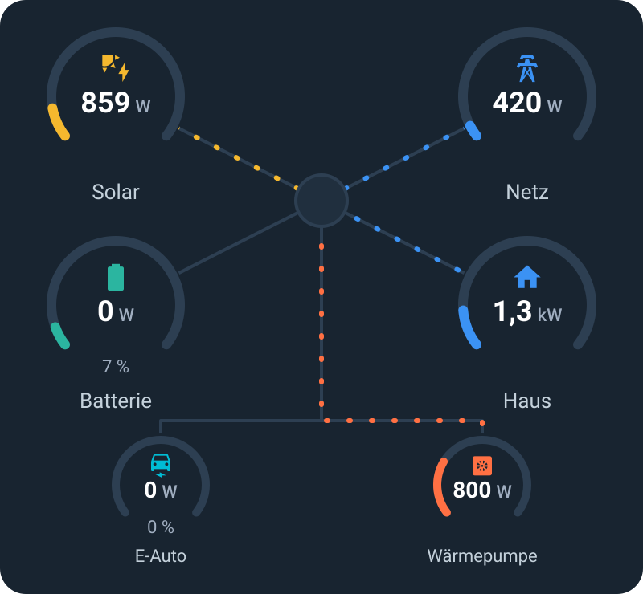

# Power Flow Refined

🇬🇧 [English](README.md) · 🇩🇪 Deutsch

Energiefluss-Karte für Home Assistant: Solar, Netz, Batterie und Haus als Kreise mit offenem Ring (256°), animierten Flusslinien und optionalen Zusatzkreisen (E-Auto, Wärmepumpe, …). Alle Farben kommen aus dem Theme „Power Flow“ (`--pf-*`, `--energy-*`), die Karte folgt damit Hell/Dunkel und allen Akzent-Varianten.



## Installation über HACS

1. HACS öffnen → Menü (⋮) → **Benutzerdefinierte Repositories**.
2. `https://github.com/wattie2k1/power-flow-refined` eintragen, Kategorie **Dashboard** wählen.
3. „Power Flow Refined“ installieren und die Seite neu laden. HACS legt die Ressource selbst an.

Design und Plan: `docs/superpowers/specs/` und `docs/superpowers/plans/`.

## Manuell bauen und installieren

```bash
npm install
npm test
./scripts/deploy.sh        # baut und kopiert nach /config/www/power-flow-refined/ (SSH-Alias "ha")
```

Danach die Dashboard-Ressource auf `/local/power-flow-refined/power-flow-refined.js?v=<n>` setzen (Typ `module`) und bei jedem Deploy `<n>` erhöhen: HA liefert `/local/` 31 Tage aus dem Cache.

## Konfiguration

```yaml
type: custom:power-flow-refined
title: Energiefluss
solar:   { entity: sensor.evcc_pv_power, max: 8000 }
grid:
  entity: sensor.grid_power
  export_entity: sensor.grid_export_power
  max: 10000
battery: { entity: sensor.evcc_battery_power, soc_entity: sensor.evcc_battery_soc, max: 5000 }
home:    { entity: sensor.evcc_home_power, max: 10000 }
extras:
  - { name: E-Auto, icon: mdi:car-electric, entity: sensor.evcc_go_e_charger_charge_power,
      max: 11000, ring: soc, ring_entity: sensor.evcc_go_e_charger_vehicle_soc }
  - { name: Wärmepumpe, icon: mdi:heat-pump, entity: sensor.wolflink_c52b_power_consumption_wp_ehz, max: 3000 }
```

### Darstellung des Solarflusses (`flow_style`)

Auf Kartenebene wählbar, Standard ist `classic`:

| Wert | Darstellung |
|---|---|
| `classic` | Linien laufen zum Zentrum, ein Ring je Kreis (bisheriges Verhalten) |
| `ring` | Der Ring von Haus, Zusatzkreisen usw. wird nach Quelle eingefärbt: Solar, Batterie, Netz. Dazu „☀ 41 %“ im Kreis |
| `lanes` | Zu jedem Verbraucher laufen zwei Spuren, eine für Solar (mit Watt-Angabe) und eine für den Rest |
| `combined` | `ring` und `lanes` zusammen |

Die Aufteilung ist rechnerisch: Jede Quelle (Solar, Netzbezug, Batterie-Entladung) wird anteilig auf alle Verbraucher verteilt. Gemessen wird nicht, welcher Strom wohin fließt. Ringe, die den Ladestand zeigen (`ring: soc`, Batterie), werden nicht aufgeteilt.

```yaml
type: custom:power-flow-refined
flow_style: ring
```

| Schlüssel je Kreis | Bedeutung |
|---|---|
| `entity` | Leistungssensor (W oder kW, nach `unit_of_measurement`) |
| `max` | Wert für volle Ringfüllung in W (Standard: Solar 8000, Netz 10000, Batterie 5000, Haus 10000, Extras 3000) |
| `invert` | Vorzeichen umkehren |
| `subtract_extras` | nur Haus: Leistung der Zusatzkreise vom Hauswert abziehen |
| `name`, `icon` | Beschriftung und Icon |
| `color` | Farbe als Name einer Theme-Variable ohne `--`, z. B. `pf-purple` (Standard: Farbe nach Kreisart) |
| `export_entity` | nur Netz: Einspeiseleistung |
| `soc_entity` | nur Batterie: Ladestand, bestimmt den Ring |
| `ring`, `ring_entity` | nur Extras: `ring: soc` zeigt den Ladestand aus `ring_entity` |
| `tap_action` | `more-info` (Standard), `navigate` mit `navigation_path`, `none` |

Vorzeichen: Batterie positiv = Entladen, negativ = Laden; Netz positiv = Bezug. Ein Fluss unter 10 W gilt als Ruhe. Fehlt eine Entität oder ist der Zustand `unknown`/`unavailable`/nicht numerisch, zeigt der Kreis grau „–“.

## Bekannte Grenzen

- Hell/Dunkel wurde nur über die Theme-Variablen geprüft (alle vorhanden), nicht live im hellen Theme.
- Die Vorzeichen von `evcc_battery_power` wurden bei 0 W nicht im Betrieb geprüft.
