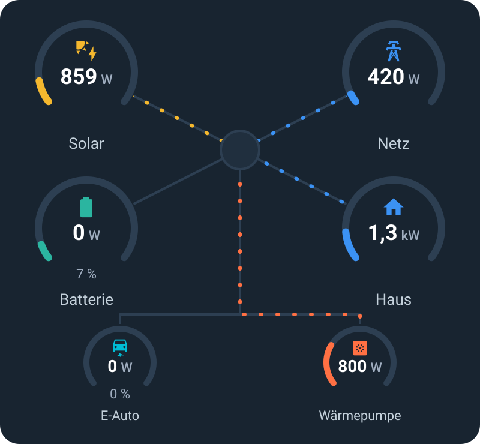

# Power Flow Refined

🇬🇧 English · 🇩🇪 [Deutsch](README.de.md)

An energy flow card for Home Assistant: solar, grid, battery and home as circles with an open ring (256°), animated flow lines and optional extra circles (EV, heat pump, …). All colors come from the "Power Flow" theme (`--pf-*`, `--energy-*`), so the card follows light/dark mode and every accent variant.



## Installation via HACS

1. Open HACS → menu (⋮) → **Custom repositories**.
2. Add `https://github.com/wattie2k1/power-flow-refined` with category **Dashboard**.
3. Install "Power Flow Refined" and reload the page. HACS registers the resource for you.

Design and plan (German): `docs/superpowers/specs/` and `docs/superpowers/plans/`.

## Manual build and install

```bash
npm install
npm test
./scripts/deploy.sh        # builds and copies to /config/www/power-flow-refined/ (SSH alias "ha")
```

Then set the dashboard resource to `/local/power-flow-refined/power-flow-refined.js?v=<n>` (type `module`) and raise `<n>` on every deploy: Home Assistant serves `/local/` with a 31-day cache.

## Configuration

```yaml
type: custom:power-flow-refined
title: Energy flow
solar:   { entity: sensor.evcc_pv_power, max: 8000 }
grid:
  entity: sensor.grid_power
  export_entity: sensor.grid_export_power
  max: 10000
battery: { entity: sensor.evcc_battery_power, soc_entity: sensor.evcc_battery_soc, max: 5000 }
home:    { entity: sensor.evcc_home_power, max: 10000 }
extras:
  - { name: EV, icon: mdi:car-electric, entity: sensor.evcc_go_e_charger_charge_power,
      max: 11000, ring: soc, ring_entity: sensor.evcc_go_e_charger_vehicle_soc }
  - { name: Heat pump, icon: mdi:heat-pump, entity: sensor.wolflink_c52b_power_consumption_wp_ehz, max: 3000 }
```

### Solar flow view (`flow_style`)

Set on the card level, default is `classic`:

| Value | View |
|---|---|
| `classic` | Lines run to the center, one ring per circle (the original look) |
| `ring` | The ring of home, extras etc. is colored by source: solar, battery, grid. Plus "☀ 41 %" inside the circle |
| `lanes` | Two lanes run to every consumer, one for solar (with its wattage) and one for the rest |
| `combined` | `ring` and `lanes` together |

The split is calculated, not measured: each source (solar, grid import, battery discharge) is distributed proportionally across all consumers. The card cannot know which electron goes where. Rings that show a state of charge (`ring: soc`, battery) are not split.

```yaml
type: custom:power-flow-refined
flow_style: ring
```

| Key per circle | Meaning |
|---|---|
| `entity` | Power sensor (W or kW, according to `unit_of_measurement`) |
| `max` | Value in W for a full ring (defaults: solar 8000, grid 10000, battery 5000, home 10000, extras 3000) |
| `invert` | Flip the sign |
| `subtract_extras` | Home only: subtract the power of the extra circles from the home value |
| `name`, `icon` | Label and icon |
| `color` | Color as the name of a theme variable without `--`, e.g. `pf-purple` (default: color by circle type) |
| `export_entity` | Grid only: export power |
| `soc_entity` | Battery only: state of charge, drives the ring |
| `ring`, `ring_entity` | Extras only: `ring: soc` shows the state of charge from `ring_entity` |
| `tap_action` | `more-info` (default), `navigate` with `navigation_path`, `none` |

Signs: battery positive = discharging, negative = charging; grid positive = import. A flow below 10 W counts as idle. If an entity is missing or its state is `unknown`, `unavailable` or not numeric, the circle turns grey and shows "–".

## Known limitations

- Light/dark was only checked through the theme variables (all present), not live in the light theme.
- The signs of `evcc_battery_power` were not verified in operation at non-zero power.
